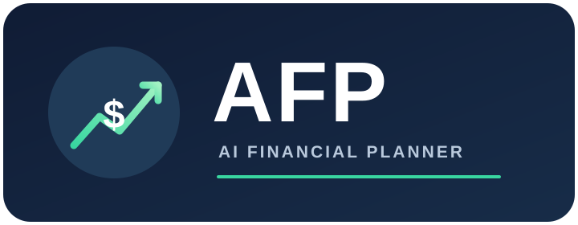
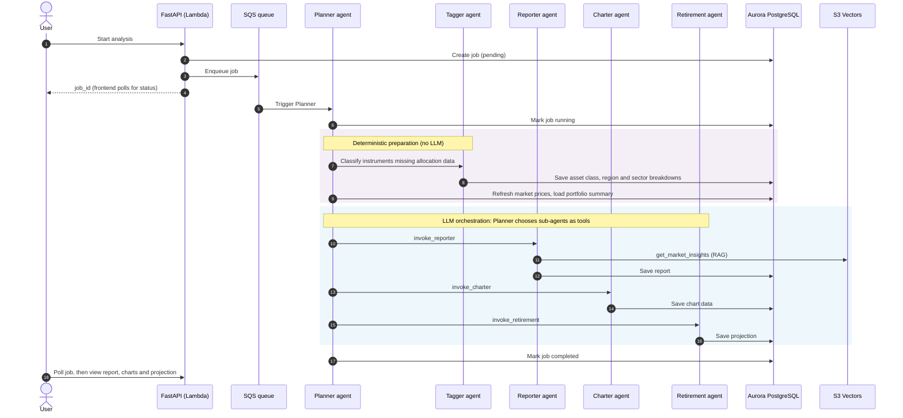
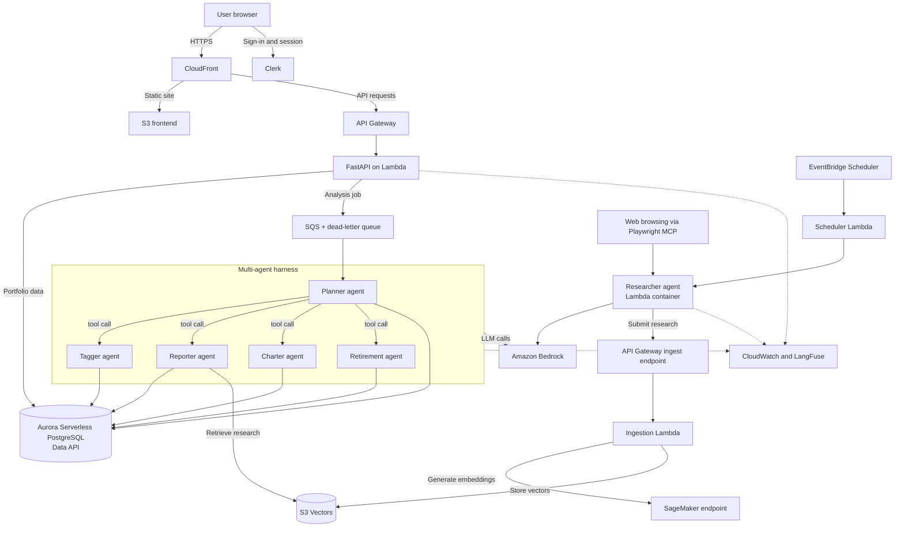

# AFP - AI Financial Planner

## A production-style multi-agent AI system on AWS



AFP is a full-stack SaaS application in which **a Planner agent orchestrates a team of specialist sub-agents** to analyze a user's investment portfolio. Each agent runs as its own AWS Lambda function, and the agents share a retrieval-augmented generation (RAG) knowledge base that an autonomous research agent keeps up to date. Users sign in, enter their accounts and holdings, and get back a written analysis, interactive charts and a retirement projection.

I built it to show the engineering involved in running agents in production, beyond prompting: orchestration, tool use, structured outputs, guardrails, asynchronous job processing, retries and dead-letter queues, observability, per-user data isolation, infrastructure as code and automated tests.

> **Important:** AFP provides AI-generated information for educational and informational use. It is not a financial advisor, and its output is not a substitute for advice from a qualified professional. See the [disclaimer](#disclaimer) below.

### Highlights

- **Multi-agent harness:** an orchestrator agent decides which of four specialist sub-agents to call for each job, and calls them as tools that invoke separate Lambda functions.
- **Several agent patterns in one system:** tool calling, Pydantic structured outputs, JSON generation, deterministic computation plus an LLM explanation, LLM-as-judge evaluation, and autonomous web browsing over MCP.
- **RAG pipeline:** a Researcher agent browses financial sources and writes research. The research is embedded with a SageMaker model, stored in S3 Vectors and retrieved by the Reporter at analysis time.
- **Production concerns:** SQS job queue with a dead-letter queue, job status tracking, exponential backoff on model rate limits, LangFuse tracing, CloudWatch dashboards, Clerk authentication with per-user data isolation.
- **Fully serverless and reproducible:** 14 AWS services defined in Terraform, in independent stages that can be deployed and destroyed one at a time.
- **Tested:** 213 unit tests across all 10 backend projects, with AWS, Bedrock, Clerk and the database mocked. They run with one command.
- **Built-in demo:** the **Watch Demo** button on the landing page plays a scripted, narrated walkthrough of an analysis run (with pause and step controls), so visitors can see the agents work without creating an account.

## The multi-agent harness

### How a job flows through the agents



The Planner is an [OpenAI Agents SDK](https://github.com/openai/openai-agents-python) agent whose only tools are the other agents. It reads a short portfolio summary and applies its instructions: call the Reporter when there are holdings, the Charter when there are at least two positions, and the Retirement agent when the user has retirement goals. Each tool call invokes a separate Lambda function. This gives every sub-agent its own timeout, memory, IAM role, logs and scaling, and lets each one be deployed and tested on its own.

### The agents

| Agent | Responsibility | Pattern it demonstrates | Runs on |
| --- | --- | --- | --- |
| **Planner** | Orchestrates each analysis job | Orchestrator agent with sub-agents as tools; deterministic steps before the LLM is called | Lambda, triggered by SQS |
| **Tagger** | Classifies ETFs and stocks by asset class, region and sector | Structured output: a Pydantic model whose validators require each allocation to sum to 100% | Lambda |
| **Reporter** | Writes the portfolio analysis report | Tool calling and RAG: retrieves market research from S3 Vectors; optional LLM-as-judge quality check | Lambda |
| **Charter** | Designs four to six charts for the frontend | JSON generation, with tolerant parsing and validation before saving | Lambda |
| **Retirement** | Projects retirement readiness | Computation in Python (500-run Monte Carlo simulation and milestone projections); the LLM explains the results | Lambda |
| **Researcher** | Researches markets and adds findings to the knowledge base | Autonomous browsing through a Playwright MCP server; runs on a schedule | Lambda container, triggered by EventBridge |

### Design decisions

- **Deterministic work stays out of the LLM.** Tagging missing instruments, refreshing prices and summarizing the portfolio run as ordinary code before the Planner's model is called. The Planner's context stays small, and its decisions depend on accurate data.
- **Numbers are computed in code, and the model explains them.** The Retirement agent runs its Monte Carlo simulation in Python and gives the model the results to interpret. Figures are reproducible and testable, and the model isn't asked to do arithmetic.
- **Each agent uses either structured output or tools, never both.** LiteLLM with Bedrock can't reliably combine the two in one agent. So each agent is built around one of them: the Tagger uses a validated Pydantic schema, and the Reporter uses tools.
- **Quality guardrail.** When LangFuse observability is enabled, a separate judge agent scores each Reporter output from 0 to 100. The score is recorded in the trace. Reports scoring below 30 are replaced with a safe fallback message rather than being shown to the user.
- **Agent context is passed explicitly.** Tools receive the job through the SDK's typed `RunContextWrapper`, not through global state, so every database read and write is tied to the job, and therefore the user, being processed.
- **Choice of model.** Agents call Amazon Bedrock through LiteLLM. The model ID and region come from Terraform variables, not code, so the model can be changed (Amazon Nova Pro by default) without a code change.

## Production engineering

| Concern | How AFP handles it |
| --- | --- |
| **Asynchronous processing** | The API returns as soon as a job is queued. The Planner Lambda consumes SQS one message at a time, and the queue's visibility timeout matches the Planner's 15-minute timeout. |
| **Failure handling** | A message that fails three times moves to a dead-letter queue. Jobs move through `pending → running → completed / failed`, and failures record an error message the UI can show. |
| **Rate limits** | Each agent retries Bedrock rate-limit errors with exponential backoff using `tenacity`, up to 5 attempts. The Retirement agent also retries timeouts and throttling. |
| **Observability** | Agent runs are traced to LangFuse through Logfire's OpenAI Agents instrumentation, along with judge scores. CloudWatch dashboards cover model usage and agent performance (`8_enterprise`), and every Lambda logs to CloudWatch. |
| **Security and multi-tenancy** | Clerk issues JWTs, and the API validates them against Clerk's JWKS. Every account, position and job query is filtered by the caller's Clerk user ID, and every write checks ownership. Unit tests confirm one user can't read or change another user's data. |
| **Data access** | Aurora Serverless v2 PostgreSQL is reached through the RDS Data API, so Lambdas need no VPC or connection pool. Inputs are validated with Pydantic before they reach the database. |
| **Cost control** | Everything is serverless or scales to zero where possible, embeddings use a SageMaker serverless endpoint, and vectors are stored in S3 Vectors rather than a dedicated vector database. |
| **Infrastructure as code** | Each part of the system is a separate Terraform stack with its own state, so stages can be deployed, changed and destroyed one at a time. |

## System architecture



## Testing

The backend has **213 unit tests across 10 projects**. They mock AWS, Bedrock, Clerk and the database, and don't load your `.env` file, so they run in seconds, cost nothing and need no deployed infrastructure. Run them all from the `scripts` directory:

```bash
cd scripts
uv run run_tests.py                  # every project
uv run run_tests.py api planner      # selected projects
uv run run_tests.py -- -x -vv        # extra options are passed to pytest
```

| Project | Tests | Main coverage |
| --- | --- | --- |
| `database` | 79 | Data API parameter and type conversion, SQL building, schema validation, table models |
| `api` | 38 | Every route; ownership checks so users can't reach each other's data; input validation; SQS messages; errors don't expose internal details |
| `planner` | 27 | Unwrapping Lambda responses, finding instruments that need tagging, portfolio summary, price refresh and fallbacks |
| `charter` | 17 | Portfolio breakdown maths; extracting and validating chart JSON from model output |
| `ingest` | 13 | Unpacking embeddings, ingest and search Lambdas |
| `tagger` | 12 | Classification validation, conversion to the database format, create-or-update logic, per-symbol errors |
| `retirement` | 10 | Portfolio value and allocation, Monte Carlo simulation with a fixed random seed, projections |
| `reporter` | 8 | Portfolio metrics and formatting, the market-insights RAG tool |
| `scheduler` | 5 | URL handling and error responses |
| `researcher` | 4 | The knowledge-base ingest tool and its retries |

Each project's tests are in its `tests/` folder. pytest is supplied by `uv run --with`, so it isn't a project dependency and never ends up in a Lambda package.

Each agent directory also has two integration scripts that call real services. `test_simple.py` runs the agent locally with real Bedrock calls but mocked sub-agent Lambdas. `test_full.py` invokes the deployed Lambda functions.

## Repository layout

| Path | Purpose |
| --- | --- |
| [`frontend/`](frontend/) | Next.js and React application, including the interactive demo |
| [`backend/planner/`](backend/planner/) | Orchestrator agent, market-price refresh |
| [`backend/tagger/`](backend/tagger/), [`backend/reporter/`](backend/reporter/), [`backend/charter/`](backend/charter/), [`backend/retirement/`](backend/retirement/) | Specialist sub-agents |
| [`backend/researcher/`](backend/researcher/) | Autonomous market-research agent and its container deployment |
| [`backend/api/`](backend/api/) | FastAPI application for the frontend |
| [`backend/ingest/`](backend/ingest/) | Embedding and vector-storage Lambdas for the RAG pipeline |
| [`backend/database/`](backend/database/) | Shared database library: Data API client, models, Pydantic schemas |
| [`terraform/`](terraform/) | AWS infrastructure, split into independent deployment stages |
| [`scripts/`](scripts/) | Local development, test runner, frontend deployment and clean-up helpers |

Each agent follows the same layout: `agent.py` builds the agent and its tools, `templates.py` holds the prompts, `lambda_handler.py` is the Lambda entry point, and `tests/` contains the unit tests.

## Technology

- **Agents and AI:** OpenAI Agents SDK, LiteLLM, Amazon Bedrock (Nova Pro), Pydantic structured outputs, Playwright MCP server, LangFuse and Logfire
- **Retrieval:** SageMaker serverless embedding endpoint (all-MiniLM-L6-v2), Amazon S3 Vectors
- **Backend:** Python 3.12, FastAPI, Mangum, tenacity, pytest, `uv`
- **Frontend:** Next.js (Pages Router), React, TypeScript, Tailwind CSS, Recharts, Clerk
- **AWS:** Lambda, API Gateway, SQS, Aurora Serverless v2 (Data API), S3, S3 Vectors, CloudFront, EventBridge, SageMaker, Bedrock, ECR, Secrets Manager, CloudWatch
- **Infrastructure:** Terraform, with a separate local state file for each stack

## Run locally

### Prerequisites

- Node.js 20 or later and npm
- Python 3.12 or later and `uv`
- Clerk application credentials
- AWS CLI credentials and access to the AWS services used by the features you want to run

The local frontend and API can run without deploying the static website, but cloud-backed data and AI workflows still need their AWS services and configuration.

### Configure and start

1. Copy the root environment template and fill in the values for your setup:

   ```bash
   cp .env.example .env
   ```

2. Create `frontend/.env.local` with your Clerk keys and local API URL:

   ```dotenv
   NEXT_PUBLIC_CLERK_PUBLISHABLE_KEY=pk_test_replace_me
   CLERK_SECRET_KEY=sk_test_replace_me
   NEXT_PUBLIC_CLERK_AFTER_SIGN_IN_URL=/dashboard
   NEXT_PUBLIC_CLERK_AFTER_SIGN_UP_URL=/dashboard
   NEXT_PUBLIC_API_URL=http://localhost:8000
   ```

   Set the Clerk issuer/JWKS values and AWS/database settings in the root `.env` as needed. Do not commit credentials or populated environment files.

3. Install frontend dependencies and start both development servers:

   ```bash
   cd frontend
   npm install
   cd ../scripts
   uv run run_local.py
   ```

   The frontend is served at [http://localhost:3000](http://localhost:3000); the API is at [http://localhost:8000](http://localhost:8000), with interactive API documentation at [http://localhost:8000/docs](http://localhost:8000/docs).

## Deploy to AWS

Deployment creates billable AWS resources. Review current AWS pricing, set billing alerts, and remove resources when they are no longer needed.

1. Configure AWS CLI credentials, choose a region, and set up Clerk and model-provider access. Copy each required `terraform.tfvars.example` to `terraform.tfvars` and enter values for that stack. Keep secrets out of source control.
2. Deploy the infrastructure stages in dependency order: `2_sagemaker`, `3_ingestion`, `4_researcher`, `5_database`, and `6_agents`. Each Terraform directory has its own local state; later stacks may read outputs from earlier state files.
3. For the Researcher container deployment, from `backend/researcher`, run:

   ```bash
   uv run deploy.py
   ```

   This builds and pushes the image to ECR and applies the Researcher Terraform configuration. Docker must be running; the script locates the project from its own path and does not require a Git repository.
4. Initialize the `terraform/6_agents` stack, configure its variables, and deploy the agent packages. From `backend`, run:

   ```bash
   uv run deploy_all_lambdas.py --package
   ```

   The helper packages the agents and applies Terraform. Run it after the database and vector-store dependencies are available.
5. From `scripts`, run the frontend/API deployment helper:

   ```bash
   uv run deploy.py
   ```

   This packages the API Lambda, applies the `7_frontend` Terraform stack, builds the frontend, uploads it to S3, and invalidates CloudFront. The helper expects the required earlier stacks, local Terraform state, and environment configuration to be in place.
6. Deploy `8_enterprise` if you want its CloudWatch dashboards for model usage and agent performance.

Each Terraform stack lists its required variables in `terraform.tfvars.example`; see [`terraform/README.md`](terraform/README.md) for how the stacks fit together.

### Clean up

Terraform state is local to each stack. Destroy stacks in reverse dependency order, preserving any state files needed to identify deployed resources:

```bash
cd terraform/8_enterprise && terraform destroy
cd ../7_frontend && terraform destroy
cd ../6_agents && terraform destroy
cd ../5_database && terraform destroy
cd ../4_researcher && terraform destroy
cd ../3_ingestion && terraform destroy
cd ../2_sagemaker && terraform destroy
```

Destroying the database deletes its data. Confirm the Terraform plan and back up anything you need before proceeding.

## Disclaimer

AFP generates informational content from automated analysis and available data. Its reports, charts, forecasts, projections, and other outputs may be inaccurate, incomplete, or out of date; they are not financial, investment, tax, or legal advice, and do not account for every user's circumstances. AFP does not guarantee any outcome or investment performance and does not act as a fiduciary or broker. You are solely responsible for evaluating the information and making your own financial decisions. Consult a qualified, appropriately licensed professional before acting on financial information. Use of AFP does not create an advisory, client, or other professional relationship.
